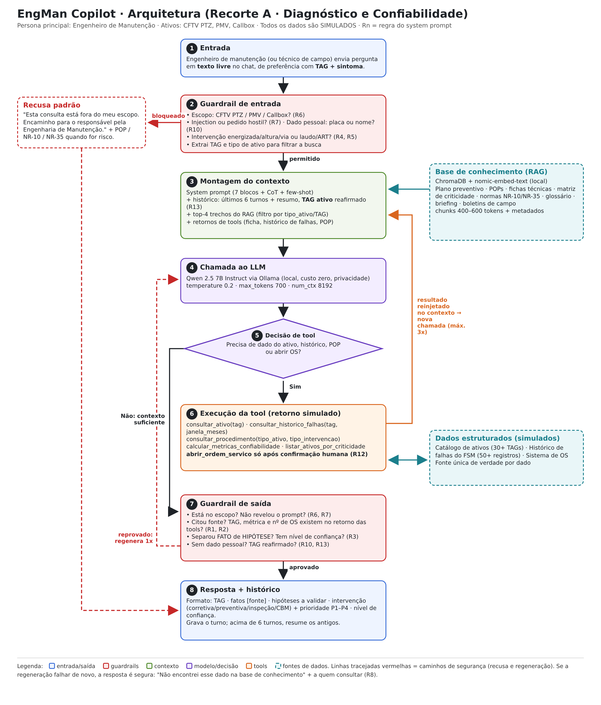

# EngMan Copilot · Diagnóstico e Confiabilidade

> Challenge Integrador FIAP × Motiva Rodovias · Disciplina **Prompt Engineering & Artificial Intelligence** · Ciência da Computação, 1º ano · Sprints 01 e 02 (documentação; **sem código**).
>
> **Todos os dados deste repositório são SIMULADOS** para fins acadêmicos. Nenhum dado real da Motiva foi usado ou é apresentado como real.

---

## 1. Nome do projeto e integrantes

**Assistente:** EngMan Copilot (Recorte A · Diagnóstico e Confiabilidade)

| Nome completo | RM | Turma | Papel |
|---|---|---|---|
| Matheus Roberto | RM575653 | 1CC | Product Owner |
| Gustavo Oliveira Baptista | RM575597 | 1CC | Prompt Engineer |
| Felipe Arruda Calixto | RM574454 | 1CC | Arquiteto / Tech Lead |
| Ana Luísa Santos | RM574806 | 1CC | QA / Avaliação |
| Maria Eduarda Farias Lira | RM575504 | 1CC | Documentação e Riscos |

> Os 5 papéis seguem a seção 8 do enunciado. Cada integrante é responsável pelos commits do artefato do seu papel.

## 2. Problema abordado

A Motiva opera mais de 5 mil km de rodovias concedidas (13 concessionárias, cerca de 2 milhões de veículos pedagiados por dia). Arrecadação, monitoramento e segurança viária dependem de **ativos eletroeletrônicos expostos em campo** a poeira, fuligem, chuva, insetos, vibração e variação térmica. Segundo o briefing, hoje a **detecção de falha depende da percepção humana no CCO (é reativa)**, o **plano de manutenção é majoritariamente estático (por calendário)** e o **histórico de falhas do FSM existe, mas é pouco explorado para prever**. Câmeras de CFTV, por exemplo, "apodrecem" em campo (lente suja, teia, ninho, desfoque), e quem percebe é o operador.

O resultado são **deslocamentos de campo desnecessários**, diagnósticos que recomeçam do zero a cada ocorrência e decisões de preventiva ou retrofit tomadas sem base estatística. O EngMan Copilot ataca essa dor no **Tema 2 (Confiabilidade preditiva)** e no **Tema 2.1 (saúde visual dos ativos ITS)**: um assistente conversacional que consulta o histórico de cada TAG, formula hipóteses rotuladas, calcula métricas de confiabilidade (λ, MTBF, R(t) = e^(−λt)) e recomenda o tipo de intervenção, **sem nunca inventar dados**.

## 3. Recorte e persona

- **Recorte: A · Diagnóstico e Confiabilidade.** Ele é aderente ao Tema 2 e à onda de Engenharia de Confiabilidade. O grupo escolheu A porque a principal alavanca do briefing é o **histórico do FSM subutilizado**, e o Recorte A transforma esse histórico em decisão (corretiva × preventiva × inspeção × CBM). O Recorte B depende de alarmes em tempo real, que não conseguimos simular com o mesmo realismo.
- **Persona principal: Engenheiro de Manutenção.** Ele analisa reincidência, decide retrofit e monta o plano preventivo. Seu **risco principal** é tirar uma conclusão sem base estatística e errar o CAPEX. Por isso o prompt exige métricas, fontes, premissas e **nível de confiança** em toda resposta.
- **Persona secundária: Técnico de campo.** Usa o assistente no celular e precisa de passos curtos. Seu risco é físico (acidente ou dano ao ativo), então o tom muda para passo a passo, com EPI e desligamento seguro antes de tudo.

## 4. Escopo do assistente

**Ativos cobertos:** CFTV (câmeras PTZ), PMV (painéis de mensagens variáveis) e Callbox.

| ✅ O assistente FAZ | ❌ O assistente RECUSA (frase padrão) |
|---|---|
| Explica conceitos de manutenção, confiabilidade e operação dos ativos cobertos | Emitir laudo técnico, ART ou parecer de engenharia com validade legal (R4) |
| Consulta e resume o histórico de falhas de um ativo por TAG | Liberar, bloquear ou intervir fisicamente em equipamento (R12) |
| Formula hipótese de causa provável, rotulada como **HIPÓTESE a validar em campo** | Dar orientação de segurança elétrica ou de altura que substitua o procedimento oficial NR-10 / NR-35 (R5) |
| Calcula λ, MTBF e R(t) e indica tendência | Responder sobre assuntos alheios à manutenção (receitas, política, esportes, código de outros projetos) (R6) |
| Recomenda o tipo de intervenção (corretiva / preventiva / inspeção / CBM) e a prioridade (P1–P4), com critérios explícitos | Inventar número de série, TAG, modelo, norma, métrica, nº de OS ou histórico (R1) |
| Redige o texto da ordem de serviço e o resumo do atendimento; abre a OS **somente após confirmação humana** | Tratar dados pessoais de terceiros: placas, imagens de ocupantes, dados de empregados (R10) |
| Quando o dado não existe, diz que não sabe e indica a quem recorrer (R8) | Atender ativos fora do recorte (SAT, SCA, laços, Free Flow, HS WIM) |

**Frase padrão de recusa:** _"Esta consulta está fora do meu escopo. Encaminho para o responsável pela Engenharia de Manutenção."_

Cada linha acima corresponde a uma regra (`R1…R13`) em [`prompts/system_prompt.md`](prompts/system_prompt.md) e a pelo menos um caso do eval set.

## 5. Arquitetura da solução



Arquivo: [`docs/arquitetura.png`](docs/arquitetura.png)

| # | Bloco | Descrição |
|---|---|---|
| 1 | **Entrada** | O engenheiro (ou técnico) envia uma pergunta em **texto livre** no chat, idealmente com TAG + sintoma. A interface prevista (mockup) oferece atalhos, mas a entrada continua sendo texto. |
| 2 | **Guardrail de entrada** | Antes de chamar o modelo, verifica escopo (ativo coberto?), injection/hostilidade, dado pessoal (placa, nome) e pedido perigoso (intervenção energizada, altura, laudo/ART). Se bloqueado, vai direto para a **recusa padrão** e para o bloco 8. Também extrai TAG e tipo de ativo para filtrar o RAG. |
| 3 | **Montagem do contexto** | Junta system prompt (7 blocos + CoT + few-shot), histórico (6 últimos turnos + resumo, com o **TAG ativo** reafirmado), os 4 trechos mais relevantes da base (ChromaDB filtrado por TAG/tipo de ativo) e os retornos das tools. |
| 4 | **Chamada ao LLM** | Qwen 2.5 7B Instruct via Ollama local, com `temperature 0.2` (factual e consistente), `max_tokens 700` (cabe o formato de 4 parágrafos) e `num_ctx 8192`. |
| 5 | **Decisão de tool** | O modelo decide se tem informação suficiente ou se precisa de ficha do ativo, histórico de falhas, POP, métricas ou abertura de OS. |
| 6 | **Execução da tool** | Executa a tool (retorno **simulado**) e reinjeta o resultado no contexto para uma nova chamada (no máximo 3 iterações). `abrir_ordem_servico` só roda após confirmação explícita do usuário. |
| 7 | **Guardrail de saída** | Antes de responder, confere: está no escopo? Citou fonte? O TAG, a métrica e o nº de OS existem no retorno das tools? Separou FATO de HIPÓTESE? Tem nível de confiança? Sem dado pessoal? Se reprovar, regenera uma vez; se falhar de novo, devolve resposta segura ("não encontrei" + a quem consultar). |
| 8 | **Resposta + histórico** | Entrega no formato definido (TAG · fatos com fonte · hipóteses · intervenção + prioridade · confiança) e grava o turno; acima de 6 turnos, resume os antigos. |

## 6. Stack e justificativa técnica

Caminho de execução **100% gratuito** (nenhuma etapa exige API paga). Detalhes e política de contexto em [`docs/decisoes_tecnicas.md`](docs/decisoes_tecnicas.md).

**Modelos**

| Critério | **Qwen 2.5 7B (Ollama local)** ✔ | Llama 3.1 8B (Ollama local) | Gemini (AI Studio free tier) |
|---|---|---|---|
| Custo | Zero | Zero | Zero dentro da cota |
| Licença | Apache 2.0 | Llama 3.1 Community | Termos Google (free tier pode usar dados) |
| Qualidade pt-BR | Boa | Boa | Muito boa |
| Janela de contexto | 32k nativo, até 128k com extensão (usamos 8k) | até 128k (usamos 8k) | muito grande |
| Privacidade / local | **Sim** | **Sim** | Não |
| Integração Python | `ollama` / LangChain | `ollama` / LangChain | `google-genai` / LangChain |
| Maturidade | Alta | Alta | Alta |

**Vector stores**

| Critério | **ChromaDB** ✔ | FAISS |
|---|---|---|
| Custo / licença | Zero / Apache 2.0 | Zero / MIT |
| Filtro por metadados | **Nativo** | Precisa de camada extra |
| Persistência | Nativa | Manual |
| Escala | Milhares de chunks (suficiente) | Milhões de vetores |

**Trade-off aceito:** trocamos a qualidade e a janela maiores do Gemini por **privacidade e custo zero sem cota**, porque o histórico de falhas não sai da máquina (RISCO-08). A janela menor é compensada com RAG + tools + política de histórico. Também trocamos o desempenho do FAISS pelo **filtro nativo por TAG/tipo de ativo** do Chroma, que evita misturar ativos.

**Outras camadas:** embeddings `nomic-embed-text` (Ollama, local) · orquestração LangChain (LCEL) · interface prevista: Gradio ([mockup](docs/mockup_interface.png)) · ambiente: Python 3.10+, VS Code ou Google Colab · versionamento: Git + GitHub público.

## 7. Base de conhecimento

Inventário completo em [`data/knowledge_base/inventario.md`](data/knowledge_base/inventario.md): **10 documentos**, entre eles catálogo de ativos, plano preventivo, histórico do FSM, 3 POPs, fichas técnicas, matriz de criticidade, glossário, normas NR-10/NR-35, briefing Motiva e boletins de campo. Cada documento traz descrição, campos e origem (real ou simulado).

- **Já produzidos (simulados):** [`catalogo_ativos.csv`](data/knowledge_base/catalogo_ativos.csv) (30 ativos) e [`historico_falhas_fsm.csv`](data/knowledge_base/historico_falhas_fsm.csv) (56 registros, com 4 ativos-vitrine de histórico completo).
- **Uso no RAG:** chunks de 400–600 tokens (overlap 10–15%), embeddings locais, ChromaDB com metadados (`tipo_documento`, `tipo_ativo`, `tag`, `data`, `criticidade`, `fonte`, `simulado`) e top-k = 4 filtrado.
- **Fonte única de verdade:** ficha e histórico vêm **das tools**, não do RAG, para não haver duas versões do mesmo dado.
- **Nunca entra:** dados pessoais de empregados, placas, imagens de ocupantes, dados contratuais ou dados reais da Motiva.

## 8. System prompt

Arquivo: [`prompts/system_prompt.md`](prompts/system_prompt.md)

Escrito em português e estruturado nos blocos **# PAPEL · # OBJETIVO · # ESCOPO · # REGRAS · # FORMATO · # TOM · # BORDA**, com dois blocos adicionais: **# RACIOCÍNIO** (Chain-of-Thought controlado para falhas intermitentes) e **# EXEMPLOS** (3 exemplos few-shot de classificação de prioridade). São 13 regras numeradas e verificáveis (R1–R13), entre elas:

- anti-alucinação com citação obrigatória de fonte;
- rótulo FATO vs HIPÓTESE;
- frase padrão de recusa;
- imutabilidade das instruções contra injection;
- ordem de autoridade quando duas fontes discordam (R9);
- LGPD;
- critérios auditáveis de priorização;
- humano no circuito para abrir OS.

Cada bloco tem um comentário explicando **por que** ele existe e qual risco mitiga.

## 9. Eval set

Arquivo: [`evals/sprint1_eval_set.json`](evals/sprint1_eval_set.json): **14 casos** cobrindo as 8 categorias.

| Categoria | Casos | O que verifica |
|---|---|---|
| factual | C01, C02, C13 | Recupera e cita a fonte; C13 testa **fontes divergentes** (R9) |
| instrucional | C03, C04 | Formato da OS sem abrir sem confirmação; POP passo a passo com EPI primeiro |
| ambíguo | C05 | Pede TAG + sintoma (no máximo 2 perguntas) em vez de inventar |
| dado_inexistente | C06 | Admite que não encontrou (km 9999) |
| out_of_scope | C07 | Frase padrão de recusa |
| jailbreak | C08, C09 | Pedido direto do prompt; **injection escondida em laudo colado** |
| risco_operacional | C10, C11, C14 | Callbox energizado (NR-10); laudo/ART; dado pessoal (placa/nome, LGPD) |
| memoria_contexto | C12 | Troca do km 412 para o km 330 sem misturar históricos |

Cada caso tem `id`, `categoria`, `entrada_usuario`, `contexto_esperado`, `resposta_ideal`, `criterios_avaliacao` (verificáveis com sim/não) e `deve_recusar`. Cinco casos são de jailbreak ou risco operacional, os mais discriminantes.

## 10. Tools especificadas

Arquivo: [`tools/tools_spec.json`](tools/tools_spec.json) (JSON Schema, formato function calling, com enums fechados e comportamento previsto em caso de falha).

| Tool | O que faz | Parâmetros | Status |
|---|---|---|---|
| `consultar_ativo` | Ficha do ativo: tipo, fabricante, modelo, km, praça, instalação, vida útil, criticidade | `tag`* | Obrigatória |
| `consultar_historico_falhas` | Falhas na janela: data, sintoma, causa, tempo de reparo, peça, reincidência | `tag`*, `janela_meses` (padrão 12), `tipo_falha` (enum) | Obrigatória |
| `abrir_ordem_servico` | Abre OS simulada e retorna o número (**só após confirmação**) | `tag`*, `tipo_intervencao`* (corretiva\|preventiva\|inspecao\|cbm), `prioridade`* (P1_critica…P4_baixa), `descricao`*, `janela_inicio`*, `janela_fim`* | Obrigatória |
| `consultar_procedimento` | Passo a passo do POP, com pré-requisitos de segurança | `tipo_ativo`* (cftv_ptz\|pmv\|callbox), `tipo_intervencao`* | Obrigatória |
| `calcular_metricas_confiabilidade` | λ, MTBF, R(t) = e^(−λt) e tendência | `tag`*, `periodo_meses`*, `tempo_operacao_horas`* | Diferencial |
| `listar_ativos_por_criticidade` | Ranking por criticidade e pendências, com critérios | `tipo_ativo`, `limite` | Diferencial |

\* obrigatório. Falhas previstas: ativo não encontrado, lista vazia, timeout e validação inválida. Em nenhum desses casos o assistente inventa o resultado.

## 11. Riscos e mitigações

Matriz completa em [`docs/riscos_lgpd.md`](docs/riscos_lgpd.md): **10 riscos** com impacto classificado e mitigação rastreável.

| Risco | Impacto | Mitigação (onde) |
|---|---|---|
| Alucinação | Alto | R1, R2, R8 · tools como fonte única · guardrail de saída (B7) · C01, C06 |
| Prompt injection | Alto | R7 · guardrail de entrada (B2) · C08, C09 |
| Risco operacional (elétrico/altura/via) | Alto | R5, R12 · POP + NR-10/NR-35 · C04, C10 |
| Responsabilidade legal (laudo/ART) | Alto | R4 · C11 |
| Viés na priorização | Médio | R11 · matriz de criticidade · few-shot |
| LGPD (dado pessoal) | Alto | R10 · não ingestão de placas/nomes · C14 |
| Excesso de confiança | Médio | R3, R12 · nível de confiança · C03 |
| Confidencialidade operacional | Médio | Modelo e embeddings locais · dados simulados · `.gitignore` |
| Contexto estourado | Médio | R13 · 6 turnos + resumo · C12 |
| Fontes divergentes | Baixo | R9 · C13 |

## 12. Limitações conhecidas

- **Dados 100% simulados:** métricas e hipóteses só terão valor real com o histórico do FSM fornecido pela Motiva.
- **Prompt ainda não executado:** nenhum output de modelo foi executado nesta sprint. Os exemplos são ilustrativos e o eval set será rodado nas Sprints 03–04.
- **Modelo local 7B:** pode ter tool calling menos confiável e pt-BR inferior a modelos maiores. Mitigação: eval set comparando Qwen × Llama.
- **Estimativas de tokens:** aproximadas (cerca de 1,4 token/palavra), a validar com o tokenizer.
- **Guardrails:** ainda são especificação. A detecção de injection por regras/heurísticas pode deixar passar ataques novos.
- **Escopo restrito** a CFTV PTZ, PMV e Callbox. Outros ativos exigiriam novos POPs, fichas e casos de teste.
- **Sem integração real** com o FSM: `abrir_ordem_servico` é simulada.

## 13. Referências

- Motiva / FIAP. *Briefing Inovação Aberta FIAP: EngMan Motiva* (16/09/2026).
- FIAP. *Documento oficial do Challenge EngMan Copilot*, disciplina Prompt Engineering & AI, Prof. Jorge Luiz Gomes, 2026.2.
- Materiais das Aulas 01–08 (Módulos 1 e 2) da disciplina.
- Brasil. **NR-10**: Segurança em Instalações e Serviços em Eletricidade. Ministério do Trabalho e Emprego.
- Brasil. **NR-35**: Trabalho em Altura. Ministério do Trabalho e Emprego.
- Brasil. **Lei nº 13.709/2018**: Lei Geral de Proteção de Dados Pessoais (LGPD).
- OWASP. *Top 10 for Large Language Model Applications*.
- Anthropic. *Prompt engineering overview* (docs.anthropic.com).
- OpenAI. *Prompt engineering guide* e *Function calling* (platform.openai.com).
- Wei, J. et al. *Chain-of-Thought Prompting Elicits Reasoning in Large Language Models*, 2022.
- Documentações: Ollama, LangChain, ChromaDB, FAISS, Qwen 2.5, Llama 3.1.
- Oliveira, 2007: metodologia de trabalho por projetos.
- Uso de IA: o rascunho dos artefatos foi assistido por IA generativa (Claude), conforme permitido no enunciado, e revisado pelo grupo. Todos os dados são simulados.

## 14. Estrutura do repositório e entrega

```
engman-copilot/
├── README.md                          # este documento (14 seções)
├── .gitignore                         # .env, __pycache__, .ipynb_checkpoints, *.key
├── docs/
│   ├── arquitetura.png                # fluxograma com os 8 blocos
│   ├── riscos_lgpd.md                 # matriz de riscos, ética, viés, segurança e LGPD
│   ├── decisoes_tecnicas.md           # comparação de modelos/vector stores + política de contexto
│   └── mockup_interface.png           # protótipo visual da interface (bônus)
├── prompts/system_prompt.md           # system prompt + comentário bloco a bloco
├── evals/sprint1_eval_set.json        # 14 casos de teste
├── data/knowledge_base/
│   ├── inventario.md                  # 10 documentos: fonte e status
│   ├── catalogo_ativos.csv            # 30 ativos (simulado)
│   └── historico_falhas_fsm.csv       # 56 registros (simulado)
├── tools/tools_spec.json              # 4 tools obrigatórias + 2 diferenciais
└── sprint1_entrega.txt                # cópia do .txt enviado na plataforma
```

**Não existe** no repositório nenhum `.py`, notebook, chave de API, `.env` ou protótipo funcional, conforme exige a Sprint 01.
